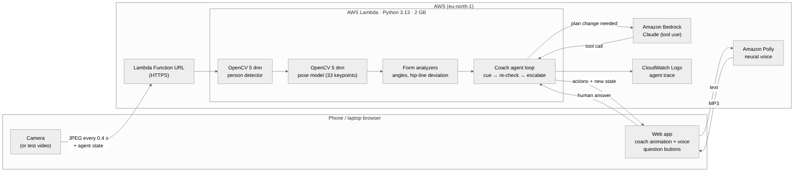
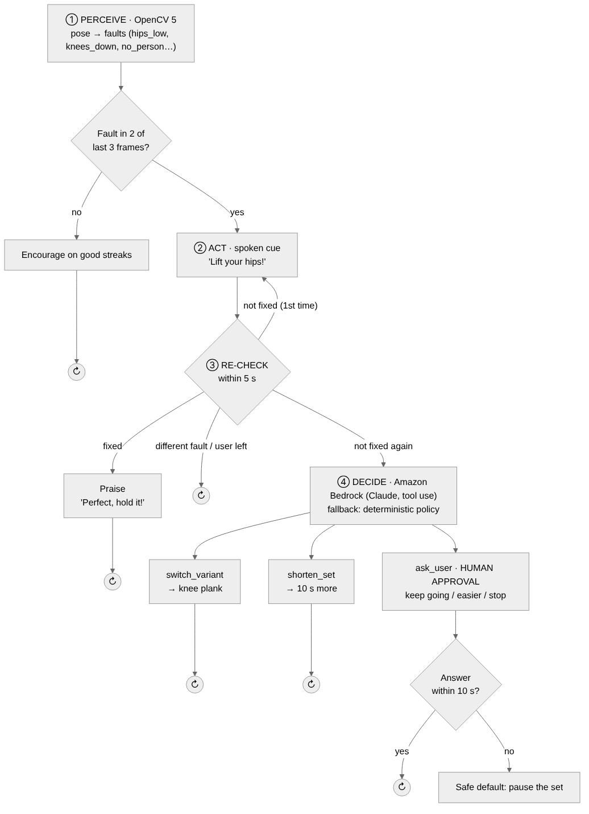
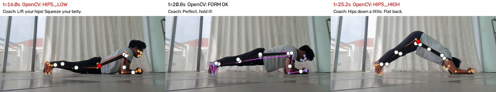

# Spotter: technical report

**A talking workout coach that watches your form with OpenCV 5 and changes the plan when your body needs it.**
OpenCV AI Competition 2026 · Agentic Vision path · Team: Hind Taouis

---

## 1. Problem and users

Most people train at home alone, following videos. A video cannot see you, so it cannot tell you that your hips are sagging in a plank. That fault puts load on the lower back instead of the core. When you get tired, a video also cannot adapt: it keeps going while your form falls apart.

**Users:** beginners and intermediate people training at home with only a phone, and the coaches who would like to give them feedback between sessions.

**Goal:** a coach that (1) sees form faults in real time, (2) tells you out loud how to fix them, (3) checks that you did, and (4) changes the workout, with your approval, when corrections stop working.

## 2. What the user experiences

1. Pick **Lower body** (squats, reverse lunges, glute bridge, side leg raises) or **Upper body** (plank, arm circles, overhead press, wall push-ups). Each is 4 × 60 s with 30 s of rest.
2. Top half of the screen: the coach, an animated character (drawn in code, original design) doing the move and talking. Bottom half: the user's camera with their skeleton drawn on top. Wrong joints turn red.
3. The coach speaks short cues ("Lift your hips!"), praises fixes ("Perfect, hold it!"), motivates ("Ten seconds left!"), and asks questions with big buttons when a plan change is needed.
4. At the end: a summary (corrections, confirmed fixes, average time to fix, plan changes, questions asked) and a downloadable agent trace.

## 3. Architecture



- **Browser** (phone or laptop): captures a 480 px JPEG every 0.4 s and sends it with the agent state. It plays the coach animation and voice and shows the questions.
- **AWS Lambda** (Python 3.13, 2 GB, Function URL over HTTPS) runs the OpenCV 5 pipeline and the agent. The server is **stateless**: the agent state travels with each request, so Lambda can scale with no database.
- **Amazon Bedrock** (Claude, Converse API with tool use) makes the plan-change decisions.
- **Amazon Polly** (neural voice) speaks the coach's lines. Audio is cached per phrase.
- **CloudWatch Logs** receives one JSON line per agent event (perceive → decide → act → re-check → human), which gives observability.

## 4. OpenCV 5 implementation

| Step | OpenCV 5 API | Details |
|---|---|---|
| Decode frame | `cv.imdecode` | JPEG from the browser |
| Find the person | `cv.dnn.readNet` + `forward` | OpenCV Zoo MediaPipe person detector (ONNX, 224×224, anchors + NMS) |
| Body keypoints | `cv.dnn` | OpenCV Zoo MediaPipe pose model (ONNX, 256×256): 33 keypoints with visibility |
| Crop and rotate person | `cv.getRotationMatrix2D`, `cv.warpAffine`, `cv.copyMakeBorder`, `cv.resize` | Aligns the body upright before the pose model |
| Visual evidence | `cv.line`, `cv.circle`, `cv.putText`, `cv.imwrite` | Annotated frames for traces and failure cases |
| Video evaluation | `cv.VideoCapture` | Offline replay of test clips |

**OpenCV 5 port note:** OpenCV 5's new DNN graph engine returns the person detector's outputs in a different order than 4.x. We match the outputs by shape. That is the only change to the OpenCV Zoo code (`server/vision/mp_persondet.py`).

**Form analysis (geometry on keypoints, `server/vision/exercises.py`):**

- **Plank (side view).** It picks the more visible body side and builds the shoulder → ankle line.
  - **Hip deviation** = signed vertical distance of the hip from that line ÷ body length. Above +0.07 → `hips_low`; below −0.09 → `hips_high`.
  - **Knee angle** (hip-knee-ankle) below 150° → `knees_down`.
  - **Shoulder lift** (shoulder above elbow ÷ body length) below 0.05, with hips not piked → `collapsed`.
  - **Body tilt** above 35° → `not_in_plank_position`.
- **Squat.** Knee angle per rep, tracked by a state machine: `shallow` if the deepest knee angle stays above 110°. In front view, knee width ÷ ankle width below 0.75 while bent → `knees_in`.
- **Other moves:** keypoint motion energy, so `not_moving` fires after 3 s still.

Thresholds are normalized by body length, so they don't depend on distance to the camera.

## 5. The agent (Agentic Vision)



*↻ = back to ① with the next frame.*

| Stage | What happens | Code |
|---|---|---|
| Perceive | OpenCV 5 output → list of faults | `exercises.py` |
| Filter | A fault must appear in 2 of the last 3 frames (anti-flicker) | `coach._persistent_fault` |
| Act | Spoken cue for that fault | `coach.step` |
| Re-check | The next frames decide: **fixed** (praise), **replaced by another fault** (no praise, handle the new one), or **not fixed** after 5 s (repeat the cue once) | `coach.step` |
| Decide | Second failed cue → Amazon Bedrock picks one tool: `switch_variant`, `shorten_set`, `ask_user` or `say`. If Bedrock is unreachable, a deterministic policy picks the same kinds of action | `brain.decide` |
| Human control | `ask_user` shows buttons (keep going / easier / stop). No answer in 10 s → safe default: pause the set | `coach.answer` |

**How vision changes the next action:** the same exercise leads to different actions depending only on what OpenCV sees. Hips back in line → praise and continue. Hips still low → repeat the cue, then a Bedrock decision. Knees on the floor repeatedly → switch to knee plank; after that, `knees_down` stops being a fault. Person gone from view → ask "Are you okay?"

### Trace from a real video

Real plank video (public, MIT licence, [Exercise-Correction](https://github.com/NgoQuocBao1010/Exercise-Correction), which shows the original project's own coloured overlay underneath ours) replayed through the full pipeline with `tools/replay_trace.py`:



| t | OpenCV 5 output | Agent event | Spoken |
|---|---|---|---|
| 12.0 s | form ok (12 s streak) | encourage | "Looking great, keep it up!" |
| 16.0 s | `hips_low` (hip deviation +0.10) | decide: cue_and_recheck | "Lift your hips! Squeeze your belly." |
| 20.8 s | form ok | **re-check: fixed** | "Perfect, hold it!" |
| 25.2 s | `hips_high` (hip deviation −0.26) | decide: cue_and_recheck | "Hips down a little. Flat back." |
| 30.0 s | `no_person` (standing up) | re-check: replaced_by → no praise | (none) |

Full trace with per-frame metrics: `docs/eval/replay_plank/trace.json`.

## 6. Evaluation

### 6.1 Vision: plank faults on real video

`eval/fetch_test_data.sh` then `python -m tools.eval_clips --clips clips --every-frame`. Segments are labeled by hand (transition frames between postures are excluded).

| Segment | Truth | Frames | Person detected | Frames correct | Clip verdict |
|---|---|---|---|---|---|
| 0–34 | good | 35 | 97.1 % | 34/34 | good ✅ |
| 41–49 | hips_low | 9 | 100 % | 9/9 | hips_low ✅ |
| 57–69 | hips_high | 13 | 100 % | 12/13 | hips_high ✅ |
| 82–99 | good | 18 | 100 % | 18/18 | good ✅ |
| **Total** | | **75** | **98.7 %** | **73/74 (98.6 %)** | **4/4** |

Pose latency (person detector + pose model, CPU, one core of the development container): **median 36.5 ms, p95 46.4 ms**. Lambda latency: *to be measured after deployment* (§7).

### 6.2 Agent: task success, failure handling, human control

`python -m tools.eval_agent` runs the real agent loop on 7 scripted observation timelines plus a Bedrock-outage test (`docs/eval/agent_scenarios.md`):

| Scenario | Expected behaviour | Pass | Corrections | Plan changes | Questions |
|---|---|---|---|---|---|
| good form, whole set | no corrections, only encouragement | ✅ | 0 | 0 | 0 |
| one-frame glitches (noise) | single-frame faults are ignored (no false alarm) | ✅ | 0 | 0 | 0 |
| hips sag, user fixes after cue | cue spoken, re-check confirms the fix, praise | ✅ | 1 | 0 | 0 |
| hips sag, user never fixes | cue, repeat, then the agent changes the plan | ✅ | 4 | 2 | 0 |
| knees drop repeatedly | switches to knee plank; knees on floor stop being a fault | ✅ | 2 | 1 | 0 |
| user leaves the camera, answers "stop" | agent asks; the human decides to stop | ✅ | 1 | 0 | 1 |
| user leaves the camera, no answer | unanswered question → safe pause after 10 s | ✅ | 1 | 0 | 1 |
| Bedrock unavailable | fallback policy decides, no crash | ✅ | - | - | - |

Plus 7 unit tests on synthetic keypoints (`pytest`).

### 6.3 Failure cases and limitations

- **Transitions are missed:** frames 5 and 75 of the test video (the person moving between postures) return no person. The agent treats `no_person` like any fault: it reacts only if it persists, so short dropouts cause no false cue.
- **One test video, one person:** the 98.6 % comes from one subject, one camera angle and one lighting. It shows the method works but is not a population-level accuracy. More clips (different bodies, clothes, floors) are the next step, and `tools/eval_clips.py` is ready for them.
- **Side view needed for planks.** Seen from the front, hip sag is not measurable. The app tells the user where to put the phone before each exercise.
- **Depth.** A 2D camera cannot see twisting toward or away from the camera.
- **Form checks today:** plank (4 faults) and squat (2). The other six moves only check that the user keeps moving.
- **Network.** Feedback arrives after one round trip; cues are not frame-instant.
- **Live camera:** the demo uses the presenter's own recorded and live attempts. Smart glasses (Meta's Wearables Device Access Toolkit gives camera access) are future work. A first-person view cannot see the body, so they would suit other exercises.

## 7. AWS deployment

One command in AWS CloudShell: `bash deploy/deploy.sh`. It:

1. Builds a Lambda zip (OpenCV 5 wheels for Python 3.13, trimmed to 226 MB unzipped, under the 250 MB limit). The app's start-up was checked with exactly that package.
2. Uploads the zip to S3.
3. Creates a least-privilege IAM role: CloudWatch Logs, `polly:SynthesizeSpeech`, `bedrock:InvokeModel`.
4. Creates or updates the function (2 GB, 30 s timeout).
5. Opens a public HTTPS Function URL.
6. Sets log retention to 14 days and prints the link.

Re-running the script updates the function in place.

**Status:** *(fill in after deployment: Function URL, measured Lambda cold/warm latency, Bedrock model id)*

**Cost:** pay-per-request only, with no server running 24/7. Bedrock is called only on escalations, not per frame. A $20 monthly spend limit is set on the account.

## 8. Responsible use

- **Privacy:** frames are analyzed in memory and discarded. No image is stored or logged; the trace contains only numbers and labels.
- **Human control:** the agent never stops or changes a set because a model said so alone. Stopping goes through the user, and silence means a safe pause, never "push through."
- **Safety tone:** motivation is encouraging, never shaming. Repeated failures lead to an easier variant, not more pressure. The home screen says to stop if something hurts.
- **Not medical advice;** not for rehabilitation without a professional.
- **Fairness:** accuracy across body types, skin tones and clothing has not been measured yet (see 6.3). That is the main evaluation gap.

## 9. How to reproduce

```bash
pip install -r requirements.txt
pytest -q                                   # unit tests
python -m tools.eval_agent --out docs/eval  # agent scenarios
bash eval/fetch_test_data.sh                # public plank test video
python -m tools.eval_clips --clips clips --out eval_out --every-frame
python -m tools.replay_trace --video clips/plank.gif --exercise plank --out eval_out/replay
uvicorn server.app:app --port 8080          # app at http://localhost:8080
```

All dependencies are pinned in `requirements.txt`.

## 10. Credits

- Pose and person-detection models and wrapper code: OpenCV Zoo (Apache-2.0).
- Plank test video: Ngô Hồng Quốc Bảo, Exercise-Correction (MIT).
- Coach character: original, drawn in code (`web/figure.js`).
